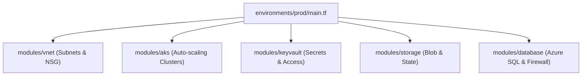

<div align="center">

# 🏗️ Azure Infrastructure Automation using Terraform

**Enterprise Modular Infrastructure as Code (IaC) Framework for Secure Multi-Tier Cloud Environments**

[](https://www.terraform.io/)
[](https://azure.microsoft.com/)
[](https://azure.microsoft.com/en-us/products/kubernetes-service/)
[](https://azure.microsoft.com/en-us/products/key-vault/)

</div>

---

## 📌 Project Overview

This repository houses the **Enterprise Terraform Infrastructure Automation** platform developed at **Reliance Industries Limited (RIL)**. It provides battle-tested, modular Infrastructure as Code to provision complete, compliant, and scalable Azure landing zones spanning Networking, Compute, Kubernetes (AKS), Key Vault, Managed Databases, and Secure Storage.

### 🌟 Key Responsibilities & Capabilities:
- **Reusable Module Architecture:** Independent modules for VNet, AKS, Key Vault, Storage, and Azure SQL.
- **Drift Detection & Lifecycle Management:** Automated plan execution preventing out-of-band drift.
- **Secrets Management:** Integrated Azure Key Vault with access policies and soft-delete protection.
- **Remote State Governance:** Azure Blob storage backend with state locking and encryption.
- **Environment Parity:** Identical modular blueprint for `dev`, `staging`, and `production`.

---

## 🏛️ Modular Architecture



---

## 📂 Project Structure

```
azure-terraform-infra-automation/
├── modules/
│   ├── vnet/                   # Virtual Network & Subnet Isolation
│   ├── aks/                    # Enterprise AKS with Dual Node Pools
│   ├── keyvault/               # HSM-Backed Key Vault & Access Policies
│   ├── storage/                # GRS Replicated Storage & TF State Container
│   └── database/               # Azure SQL Server & Database
├── environments/
│   ├── dev/                    # Development environment overrides
│   └── prod/                   # Production environment root caller
│       ├── main.tf
│       ├── variables.tf
│       ├── terraform.tfvars
│       └── backend.tf
├── scripts/
│   └── deploy.sh               # CI/CD validation and plan generation script
└── README.md
```

---

## 🚀 Usage & Deployment

```bash
# 1. Switch to target environment
cd environments/prod

# 2. Initialize modules and remote backend
terraform init

# 3. Validate syntax & configuration
terraform validate

# 4. Preview execution plan
terraform plan

# 5. Apply changes to Azure
terraform apply
```

---

## 🏆 Business Impact & Achievements
- **Provisioning Velocity:** Reduced end-to-end Azure environment provisioning time from several days to under 45 minutes.
- **Consistency:** 100% elimination of configuration drift across dev and production.
- **Enterprise Scale:** Successfully governing 500+ cloud resources with automated auditability.

---

**Author:** [Anil Kumar](https://www.linkedin.com/in/anil-kumar-58a08b3b4/) | Senior DevOps & Cloud Engineer
